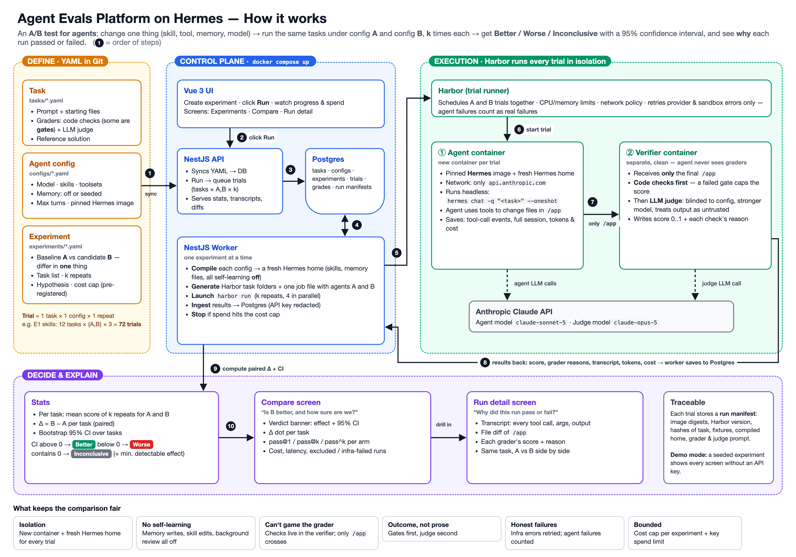

# Design

An A/B test platform for agents. Change one thing in a Hermes configuration (skill, tool,
memory or model), run the same tasks under the baseline (A) and the candidate (B) k times each,
and get **Better / Worse / Inconclusive** with a 95% confidence interval. Every run can be
opened to see **why** it passed or failed.



The diagram shows step 9 in the worker; in the build, the API computes the statistics when they
are read (see [Statistics](#statistics)).

## Concepts

| Term | Meaning |
|---|---|
| Task | Prompt + starting files + graders (`tasks/<slug>/task.yaml`, `fixtures/`, `checks/`, `solution/`) |
| Config | Model, skills, toolsets, memory (off or seeded), turn budget, pinned Hermes digest (`configs/*.yaml`) |
| Experiment | Tasks × {A, B} × k repeats, hypothesis, held-out tasks, threshold, cost cap, seed (`experiments/*.yaml`) |
| Trial | One task × one config × one repeat, in a fresh container with a fresh Hermes home |
| Verdict | From the bootstrap CI of the mean paired task delta |

Rule: A and B may differ only in the experiment's factor. `factorViolation` enforces this in the
YAML sync and the API; image digest and turn budget must always match.

## Components

```
apps/api       NestJS: YAML sync, REST API (/api/v1), stats on read, trial files, demo seed loader
apps/worker    NestJS: queue poller, config compiler, Harbor launcher, result ingestion, budget stop
apps/web       Vue 3 + Vite + Tailwind + ECharts: Experiments, New experiment, Compare, Run detail
packages/shared  zod schemas and types for YAML, Hermes and Harbor files, API DTOs
packages/db      Prisma schema, migrations, client (shared by api and worker)
packages/grader  grader CLI that runs in the verifier container (code checks + LLM judge)
packages/stats   pure statistics (bootstrap, MDE, pass@k), no I/O
hermes_harbor/   Harbor adapter for Hermes (Python, ~300 lines), plus a fake agent for the e2e test
docker/          one multi-stage Dockerfile (api, worker, web, migrate, verifier) + Hermes runner image
```

`docker compose up` starts Postgres, a one-shot migration, the API, the worker (with the host
Docker socket), the web app (nginx) and two build-only services that tag the Hermes runner and
verifier images.

## How a run works

1. **Define.** Tasks, configs and experiments live in Git as YAML. The API syncs them into
   Postgres at startup and on `POST /sync`, validating everything with the shared zod schemas
   and reporting `file:line:col` errors. Experiments can also be created in the UI.
2. **Queue.** `POST /experiments/:id/run` moves a draft to `queued` and creates the pending trial
   matrix. Runs need `ANTHROPIC_API_KEY`.
3. **Prepare.** The worker claims the experiment (`FOR UPDATE SKIP LOCKED`). For each config it
   compiles a content-addressed **Hermes home bundle**. For each task it generates a **Harbor
   task directory**. It writes one Harbor `job.yaml` with two agents, A and B, and a manifest
   with image ids, the Harbor version, and config, task and judge-prompt hashes.
4. **Run.** `harbor run -y -c job.yaml` runs k attempts of every task for both agents at the
   chosen concurrency. Per trial:
   - **Agent container:** the pinned Hermes image plus the task fixtures in `/app`; CPU and
     memory limits; network allowlist `api.anthropic.com`. The adapter wipes `/opt/data`, uploads
     the home bundle and runs
     `hermes -m <model> --provider anthropic -t <toolsets> [--skills …] --yolo --in /app chat --query-file … --oneshot --format stream-json --max-turns N`.
     It then saves the stream-json events, the full session export (`hermes sessions export`) and
     a list of files written under the Hermes home (isolation evidence).
   - **Verifier container** (separate, clean): only `/app` crosses over. `test.sh` runs the
     grader with the task's grader spec, which carries no config or model name. The grader writes
     `reward.json` for Harbor and `grades.json` with every check's score and reason.
5. **Ingest.** The worker scans Harbor's trial directories while the job runs and once after it
   exits. It classifies failures with Harbor's error policy, redacts the API key from every
   stored file, copies events, session and workspace to `trials/<id>/`, and writes trial, grades
   and manifest rows in one transaction.
6. **Budget.** After each ingest pass: if spend ≥ the cost cap or a stop was requested, SIGTERM
   Harbor, then SIGKILL after 30 s.
7. **Decide and explain.** The API computes statistics on read; the UI shows Compare and Run
   detail.

## Isolation: making A and B comparable

Hermes learns by default, so every learning path is off and nothing survives a trial:

| Concern | Measure |
|---|---|
| Shared state between trials | New container and fresh Hermes home per trial; bundles are read-only inputs |
| Bundled skills leaking into the baseline | `.no-bundled-skills` marker; only the config's skills are copied in |
| Memory and skill writes | memory off: `memory_enabled: false`, `user_profile_enabled: false`, `memory` and `skills` toolsets disabled. Seeded: memory files copied in, `write_approval: true` (writes are staged and die with the container) |
| Background self-review | `auxiliary.background_review.enabled: false` |
| Agent tampering with graders | Checks live only in the verifier image and `tests/`; the agent never sees them |
| Judge bias | Different, stronger model (`claude-opus-5`); blind to config and model; each file is fenced as untrusted with a random nonce |
| Network | Agent phase: allowlist sidecar, only `api.anthropic.com`. Verifier: no network unless the task has a judge |

All of this was verified in the day-1 spike (`docs/spike-notes.md`).

## Grading

Graders, in spec order: `file_exists`, `regex`, `json` (partial credit per expected key),
`command` (a checker script, `bash -lc` in its own process group, timeout, API key removed from
its environment), then `llm_judge`.

- **Gates first.** A check marked `gate: true` that fails caps the task score at 0.2 and skips the
  judge, so well-written prose cannot hide a wrong answer.
- **Score** = weighted sum (weights sum to 1); **passed** = score ≥ the experiment's threshold
  (0.8).
- **Judge**: Messages API with a zod structured output
  `{score, passed, unknown, reason, evidence}`. Malformed or refused output is retried once, then
  the trial is a `verifier_failed` exclusion. No sampling parameters, because `claude-opus-5`
  rejects them. Calibration: `judge-calibration.md`.
- **Reference solutions.** Every task has `solution/solve.sh`; `pnpm oracle` runs Harbor's oracle
  agent through the real verifier and must score 1.0 on every task.

## Failures

Harbor's error policy, copied into `@evals/shared`:

| Outcome | Example | Treatment |
|---|---|---|
| Valid failure | agent ran out of turns or time, wrong answer | Scored (0 if nothing gradable); counts against the config |
| Infrastructure failure | provider 429/5xx, sandbox or verifier error | Retried by Harbor (2 retries); if still failing, **excluded** and counted per arm |

Retrying agent failures would bias results, so they are never retried. In E1–E3, 0 of 216
trials were excluded.

## Statistics

The estimand is the mean of B − A task scores over this suite (`packages/stats`, pure,
deterministic).

1. Per task and arm: mean score over valid repeats. Invalid trials are excluded and counted.
2. Paired delta per task: `d[t] = mean_B[t] − mean_A[t]`.
3. Effect = mean of `d`. 95% CI = percentile bootstrap over tasks (10,000 draws, `mulberry32`
   seeded with the experiment seed, R type-7 quantiles). Sensitivity: a two-stage bootstrap
   (tasks, then repeats).
4. Verdict: CI above 0 → Better, below 0 → Worse, else Inconclusive. Better or Worse also needs
   at least **6 paired tasks**: below that, a percentile bootstrap is above 0 whenever every
   delta is positive, while a sign test is significant at 5% only from n = 6.
5. MDE (retrospective) = (1.96 + 0.84) × SD(d) / √n: 95% confidence, 80% power.
6. Also reported: per-task deltas (dot plot and table, flaky flag when repeats differ by SD
   > 0.25), pass@1, pass@k, pass^k, gate failures, failure causes, cost per trial and per pass,
   latency, tokens.

The API computes statistics on read (≈ 16 ms for 72 trials) and caches them in `StatsSnapshot`,
keyed by the number of ingested trials, so a cached value never outlives new data.
`pnpm rescore` reuses the same function for sensitivity analyses.

## Reproducibility

- Hermes pinned by digest (v0.22.2, multi-arch index), Harbor 0.24.0, `claude-sonnet-5` /
  `claude-opus-5`.
- Each trial's run manifest stores image references and ids, the Harbor version, and hashes of
  the task YAML, the generated Harbor task, the compiled home bundle and the judge prompt.
- Experiments are pre-registered: the YAML (hypothesis, tasks, held-outs, threshold, k, seed,
  cap) is committed before the run, and a non-draft experiment is locked against YAML changes.

## Key decisions

| Decision | Choice | Why | Alternative |
|---|---|---|---|
| Trial runner | Harbor behind the worker | Containers, limits, network policy, separate verifier, retries and result layout already exist; saved about a day | Direct Docker runner (planned fallback, not needed) |
| Headless Hermes | `chat --oneshot --format stream-json` + session export | Tool events and exit code; the export has full tool outputs (events cap them at 5,000 chars) | `-z` prints only the final text |
| Queue | Worker polls Postgres, one experiment at a time | Harbor owns concurrency; no extra broker | pg-boss, Redis |
| Stats location | API, on read, cached | Always consistent with ingested trials; cheap | Worker computes at completion |
| Grading | Code checks with gates, judge second, separate container | Deterministic where possible; agent cannot touch checkers | Judge-only grading |
| Judge model | Opus for a Sonnet agent | Avoid self-preference; stronger grader | Same model as the agent |
| Score | Weighted 0..1 with partial credit | Narrows the CI compared with pass/fail | Binary pass/fail |
| Demo | Seed of E1–E3 loaded into an empty DB at API startup | The reviewer sees real results without a key | Static screenshots |
| UI state | Polling every 5 s | Simple, enough for minute-long trials | Server-sent events |

## Dependencies

| Component | Version | License |
|---|---|---|
| Hermes Agent (system under test) | v0.22.2, pinned digest | MIT |
| Harbor (trial runner) | 0.24.0 | Apache-2.0 |
| NestJS | 11 | MIT |
| Prisma | 7.10 | Apache-2.0 |
| PostgreSQL | 16 | PostgreSQL License |
| Vue / vue-router | 3.5 / 5.4 | MIT |
| Vite / Vitest | 8 / 4 | MIT |
| Tailwind CSS / Headless UI | 4.3 / 1.7 | MIT |
| ECharts / vue-echarts | 6.1 / 8.3 | Apache-2.0 / MIT |
| zod | 4 | MIT |
| @anthropic-ai/sdk | 0.135 | MIT |
| jsdiff (`diff`) | 9 | BSD-3-Clause |
| yaml | 2.9 | ISC |
| Jest | 30 | MIT |

Versions are the ones in `pnpm-lock.yaml` and `docker/`. Toolchain notes (why NestJS 11, Node
20.19+, TypeScript 6) are in `implementation-plan.md` §16.
