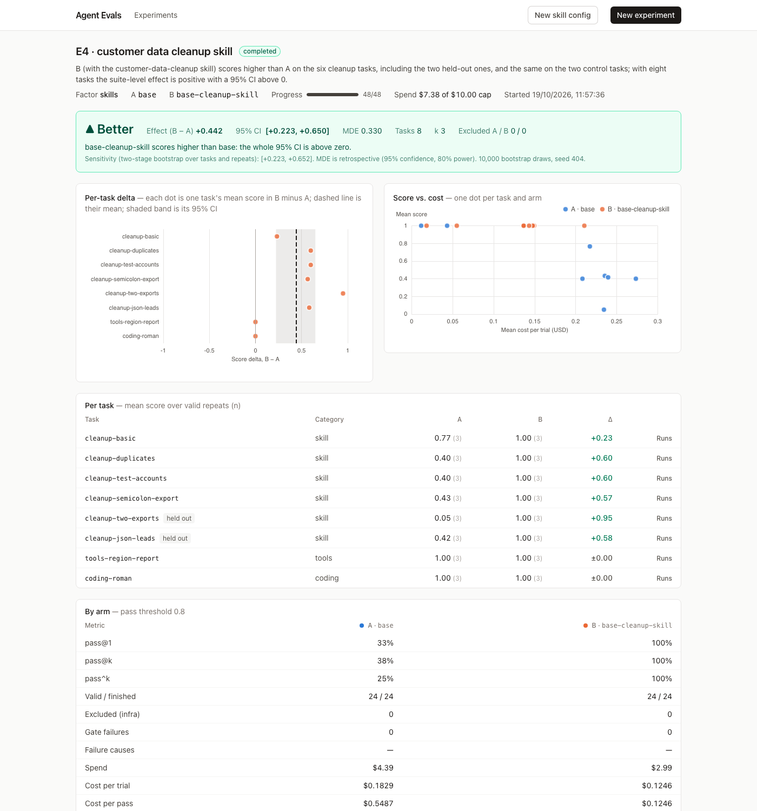

# Results: E1–E4

Run on 2026-10-19 on the compose stack (Docker Desktop, Apple silicon), Hermes v0.22.2
(pinned digest), agent `claude-sonnet-5`, judge `claude-opus-5`, Harbor 0.24.0. Each experiment:
12 tasks × 2 configs × 3 repeats = 72 trials, concurrency 4, pass threshold 0.8. The designs
were committed before any run (`experiments/*.yaml`, commit `950d6a5`). The demo seed contains
all three experiments, so every number and trial below can be opened in the UI
(`/trials/<id>`; ids are prefixes here).

## Summary

| | Change (A → B) | Verdict | Effect (B − A) | 95% CI | MDE | Agent spend | Time |
|---|---|---|---|---|---|---|---|
| **E1 skills** | no skill → `changelog-format` skill | Inconclusive | +0.203 | [−0.006, +0.439] | 0.317 | $2.24 | 20 min |
| **E2 tools** | `[terminal]` → `[terminal, file]` | Inconclusive (tool errors 28 → 14) | −0.017 | [−0.039, 0.000] | 0.034 | $2.72 | 19 min |
| **E3 memory** | memory off → memory seeded | Inconclusive (as recorded) | +0.151 | [−0.056, +0.389] | 0.332 | $2.43 | 17 min |
| E3, corrected grader | same | **Better** (sensitivity, see below) | +0.193 | [+0.010, +0.407] | 0.291 | | |
| **E4 cleanup skill** (showcase) | no skill → `customer-data-cleanup` skill | **Better** | **+0.442** | **[+0.223, +0.650]** | 0.330 | $7.38 | 70 min |

No trial was excluded and no infrastructure failure occurred in any of the 264 trials. E1–E3
use the 12-task suite (72 trials each); E4 uses 6 cleanup tasks plus 2 controls (48 trials).

**In one paragraph:** both the skill and the seeded memory do exactly what they should on the
tasks that depend on them. B scores 1.00 on every one of those tasks in every repeat, including
the held-out ones, and nothing moves elsewhere. But the pre-registered measure is the mean delta
over **all 12 tasks**. Each factor touches 3 of them, so the effect is diluted to about 0.2. With
a between-task spread that large, the bootstrap CI reaches zero (MDE ≈ 0.32). The file toolset
(E2) makes no difference, because the shell already covers every task.


## E4: customer data cleanup skill (showcase)

**Why a fourth experiment.** E1 and E3 showed the skill and the memory working on their target
tasks, while the 12-task estimand diluted the effect. E4 was designed so the skill's own tasks
are most of the suite. It tests a second skill, `skills/customer-data-cleanup`: a house standard
for cleaning customer exports (column mapping, E.164 phones, ISO countries, UTC timestamps,
test-account removal, a duplicate-merge rule, a fixed report). The skill was committed before
its tasks were written (commit `9e90965`).

Hypothesis (pre-registered, `experiments/e4-cleanup-skill-v2.yaml`): *B scores higher than A on
the six cleanup tasks, including the two held-out ones, and the same on the two control tasks;
with eight tasks the suite-level effect is positive with a 95% CI above 0.*



| Task | A | B | Δ |
|---|---|---|---|
| cleanup-basic | 0.77 | 1.00 | +0.23 |
| cleanup-duplicates | 0.40 | 1.00 | +0.60 |
| cleanup-test-accounts | 0.40 | 1.00 | +0.60 |
| cleanup-semicolon-export | 0.43 | 1.00 | +0.57 |
| cleanup-two-exports (held out) | 0.05 | 1.00 | +0.95 |
| cleanup-json-leads (held out) | 0.42 | 1.00 | +0.58 |
| tools-region-report (control) | 1.00 | 1.00 | 0.00 |
| coding-roman (control) | 1.00 | 1.00 | 0.00 |

| Part of the hypothesis | Outcome |
|---|---|
| B higher on all six cleanup tasks, held-out included | ✅ B 1.00 in all 18 cleanup trials |
| Controls unchanged | ✅ both 1.00 in both arms |
| Suite-level CI above 0 | ✅ **Better**, +0.442 [+0.223, +0.650]; two-stage [+0.223, +0.652] |

Per arm: pass@1 33% → **100%** (B passed 24 of 24 trials); cost per trial $0.183 → $0.125; cost
per pass $0.549 → $0.125; failed tool calls 32 → 7. On cleanup tasks B's agent also finishes
faster (median agent time 95 s vs 156 s). Wall-clock trial duration is not comparable here: one
B trial waited 41 minutes in Harbor's verifier phase (infrastructure, not the agent).

Why A fails (failed checks over its 18 cleanup trials): without the standard, Hermes writes a
careful but different cleanup.
- **Report format** (18 of 18): it invents its own report keys.
- **Kept records** (14): it merges duplicates by its own rule. It keeps the older record (ids
  201/203 instead of 209/211), or merges two customers with no email by name, which the standard
  forbids.
- **Timestamps** (13): `+00:00` instead of `Z`, or a non-standard column name.
- **Phones** (10): taken from the wrong duplicate.
- **Header** (9): input column names (`customer_id`, `full_name`) or extra columns.
- In the held-out two-export task it also created new ids (`CUST-0001`…) and kept the originals
  in extra columns.

**Robustness.** The content checks match rows by `id`, so A's new ids on `cleanup-two-exports`
also zeroed its email, phone, country and timestamp checks there. Re-grading those three trials
with rows matched by email gives A 0.50, 0.35 and 0.50; `pnpm rescore` then gives **Better,
+0.392 [+0.208, +0.546]**. The verdict does not depend on that choice.

**v1 was stopped.** The first run (`e4-cleanup-skill`) was stopped after 12 of 48 trials
($1.59). Its content checks read only the standard column names, so a baseline that kept
`customer_id` got 0 for correct content (0.05 instead of 0.40–0.50 on two tasks). The checks now
accept the standard's column aliases and only `format` requires the exact header. The design was
otherwise unchanged and re-registered as v2 before it ran. v1 stays in the database as a stopped
run and is not in the demo seed.

## How to read the numbers

- **Effect** = mean over tasks of (B's mean score − A's mean score); scores are 0..1 after gates.
- **95% CI** = percentile bootstrap over tasks, 10,000 draws, the experiment's seed. The
  two-stage bootstrap (tasks, then repeats) is shown as a sensitivity check and agrees in all
  three experiments.
- **Better / Worse** needs the CI to exclude 0 *and* at least 6 paired tasks.
- **MDE** = retrospective minimum detectable effect at 95% confidence and 80% power, from the
  observed spread of the task deltas.
- The CI describes **this suite only**, not Hermes in general.

## E1: changelog skill (headline)

Hypothesis (pre-registered): *B scores higher on the three skill tasks, including the held-out
PR-based task, and the same on the other nine; the suite-level effect is positive with a 95% CI
above 0.*

| Task | Category | A | B | Δ |
|---|---|---|---|---|
| skill-changelog-release | skill | 0.03 | 1.00 | **+0.97** |
| skill-changelog-breaking | skill | 0.42 | 1.00 | **+0.58** |
| skill-changelog-prs (held out) | skill | 0.05 | 1.00 | **+0.95** |
| memory-invoice-summary | memory | 0.45 | 0.38 | −0.07 |
| the other 8 tasks | tools, coding, memory, open | same | same | 0.00 |

| Part of the hypothesis | Outcome |
|---|---|
| B higher on all three skill tasks, held-out included | ✅ every repeat, 9 of 9 pairs |
| Unchanged elsewhere | ✅ largest other |Δ| is 0.07 (one task, within repeat noise) |
| Suite-level CI above 0 | ❌ lower bound −0.006 |

Per arm: pass@1 0.50 → 0.75; cost per passing trial $0.072 → $0.035; tool errors 15 → 10. On the
skill tasks alone B is also cheaper and faster ($0.027 vs $0.076 and 49 s vs 81 s per trial),
because it does not search the filesystem for a format to follow.

Why A fails the skill tasks (from Run detail): without the skill, Hermes writes a reasonable
but generic changelog. It invents section names ("Breaking Changes", "Features", "Bug Fixes",
"Documentation"), lists internal commits (docs, refactor, CI), uses its own bullet style and
heading, and leaves out the thanks line. In one repeat (`b0af2019`) it searched for an existing
changelog or style guide, found none, and asked for an example instead of writing anything. A scores higher on
`skill-changelog-breaking` (0.42) because that task ships an older entry in house format, which
it partly imitates.

## E2: file toolset

Hypothesis: *B scores at least as high as A, with fewer tool errors on the file-editing tasks;
a small effect is expected, so Inconclusive is a likely and acceptable outcome.*

Every task has the same mean in both arms except `skill-changelog-breaking` (0.53 vs 0.47,
flagged flaky: repeats disagree by more than 0.25) and `memory-expenses-csv` (0.13 vs 0.00: in
one A repeat Hermes wrote the CSV to the root instead of asking where to save it). Effect −0.017,
CI [−0.039, 0.000]: no detectable difference in score, as expected. With `[terminal]` only,
Hermes does all its file work through the terminal tool (137 terminal calls) and succeeds just as
often. The tool-error part of the hypothesis holds: **failed tool calls halve with the file
toolset (28 → 14)**. Tool errors are reported, not part of the verdict.

## E3: seeded memory

Hypothesis: *B scores higher on the three memory tasks, including the held-out email task, and
the same on the other nine; the suite-level effect is positive with a 95% CI above 0.*

| Task | A | B (recorded) | B (corrected grader) |
|---|---|---|---|
| memory-expenses-csv | 0.00 | 1.00 | 1.00 |
| memory-invoice-summary | 0.45 | 1.00 | 1.00 |
| memory-vendor-email (held out) | 0.25 | 1.00 | 1.00 |
| tools-region-report | 1.00 | **0.50** | 1.00 |
| the other 8 tasks | — | Δ within ±0.08 | same |

Why A fails the memory tasks: without memory, Hermes does not know where "my reports" go.
On `memory-expenses-csv` it **asks** instead of writing the file, which in a one-shot run means no
output (score 0). Elsewhere it writes the file in the root, with English number and date formats,
and a "Dear Marco … Best regards" email. With memory, it applies every preference: `reports/`,
`;` CSVs, `11.735,67 €`, `15.09.2026`, "Hallo Marco … Viele Grüße / Priya".

### Grader bug found in E3, and the sensitivity result

With memory on, Hermes also applied the user's German number format to the unrelated
`tools-region-report` task (`| north | 2.150,75 € |`). The task's checker removed commas and read
that as 2.15, so all three memory-arm trials lost 0.5 on a correct answer. This was an
objective grader bug: the prompt does not ask for a number format.

- The checker now parses both formats (same parser as the memory checkers).
- Re-grading **all 18** `tools-region-report` trials of E1–E3 with the fixed checker changes only
  those 3 trials (0.5 → 1.0). Log: `results-data/e1-e3-region-report-regrade.txt`.
- The database keeps the recorded scores. The corrected result comes from
  `pnpm rescore <experiment> <trial>=<score>…`, which recomputes the stats with the same code and
  seed. Run without replacements, it reproduces the recorded numbers exactly.
- **Corrected E3: Better, effect +0.193, CI [+0.010, +0.407].** Because the fix was made after
  seeing the data, treat this as a disclosed sensitivity result, not as the pre-registered
  verdict.

The bug itself is a finding: memory changes behaviour **beyond** the tasks it was seeded for.
Here that change was harmless, but a stricter grader scored it as a failure.

## What would make E1 and E3 conclusive

The effects are large and consistent where they apply; the limit is the estimand. Options, all
of which need a new pre-registered experiment rather than a re-analysis:

1. Make the target category the primary estimand (3 tasks × 3 repeats is still below the
   6-task minimum, so add skill or memory tasks: about 6–8 per factor).
2. Keep the whole-suite estimand but run more tasks (the MDE shrinks with √n).
3. Report the target-category delta as a pre-registered secondary outcome.

## Judge agreement

- Calibration: 24/24 verdicts agree with the labels on 12 cases (2 real, 10 crafted, 2 injection
  attempts), with no score error. Details and caveats: `judge-calibration.md`.
- Real runs: the judge graded the 18 `open-docs-onboarding` trials, all 1.0. A manual read of a
  sample (`791bb47d`: all seven facts, 235 words) agrees. The task is at the ceiling for Sonnet 5,
  so it does not separate configs.
- No judge/code disagreement is possible in E1–E3: the only judged task has no overlapping code
  check besides the word count, which passed in all 18 trials.

## Transcripts (fixed rule)

The rule from the plan: every A/B disagreement, every exclusion, every judge/code disagreement,
plus 2 agreements per experiment (the two with the lowest A-trial id). There were no exclusions
and no judge/code disagreements. "Disagreement" means one arm passed and the other did not, for
the same task and repeat. Each "why" is the failed checks' own messages, shown in Run detail.

### E1 (9 disagreements)

| Task, repeat | A | B | Why A failed |
|---|---|---|---|
| skill-changelog-breaking, 1 | 0.30 `e57cc301` | 1.00 `3914735a` | Sections "Breaking Changes" and "Documentation"; docs commit #512 listed; no thanks line |
| skill-changelog-breaking, 2 | 0.30 `3c77200b` | 1.00 `4c2ebb66` | Breaking change filed under Added; "Documentation" section; no thanks line |
| skill-changelog-breaking, 3 | 0.65 `52f95321` | 1.00 `3e9e330a` | "Breaking Changes" heading; #501 in two sections; bullet text from the footer |
| skill-changelog-prs, 1–3 | 0.05 `883fc10a` `ef12b947` `1737579d` | 1.00 `8fb9bdb1` `9a6aaaae` `fb5cb6c2` | Wrong heading; internal PR #603 listed; "Features"/"Bug Fixes" sections; author in each bullet |
| skill-changelog-release, 1 | 0.00 `b0af2019` | 1.00 `8ad9554e` | No CHANGELOG.md written: asked for an example of the house format |
| skill-changelog-release, 2–3 | 0.05 `c8849fed` `55c59bb9` | 1.00 `b4c0afe5` `bbddb5a6` | Internal commits #413 #416 #420 #422 listed; wrong heading and sections |
| agreement: memory-invoice-summary, 1 | 0.45 `09490ad2` | 0.45 `98c011de` | Both arms lack memory: English formats, file in root |
| agreement: coding-fix-slugify, 3 | 1.00 `135d6dcf` | 1.00 `04575cd2` | Both pass |

### E2 (1 disagreement)

| Task, repeat | A | B | Why |
|---|---|---|---|
| skill-changelog-breaking, 1 | 0.65 `a039308d` | 0.80 `ea18a615` | A put #501 under "Removed" and missed #511 as breaking; B passed at exactly 0.80 |
| agreement: memory-expenses-csv, 2 | 0.40 `0d4fb160` | 0.00 `e4c72c72` | Both fail: A wrote a comma CSV in the root, B asked where to save it |
| agreement: skill-changelog-prs, 2 | 0.05 `128899b6` | 0.05 `0704d386` | Both fail without the skill |

### E3 (12 disagreements)

| Task, repeat | A | B | Why |
|---|---|---|---|
| memory-expenses-csv, 1–3 | 0.00 `16ab7230` `16fadb20` `31e96922` | 1.00 `25023a67` `02035713` `b473d0ab` | A asked where to save and wrote nothing |
| memory-invoice-summary, 1–3 | 0.45 `c8cc098e` `2b6be888` `12d17a82` | 1.00 `0545e475` `ad959417` `14be32ca` | A: file in root, total `11,735.67`, date `2026-09-15` |
| memory-vendor-email, 1–3 | 0.25 `dbdb804c` `6729a4a0` `f513857a` | 1.00 `bbe8fd35` `43abf204` `a204a301` | A: "Dear/Hi Marco", "Best regards", English amount and date |
| tools-region-report, 1–3 | 1.00 `aebd91f9` `03f5a45e` `bd1e26d8` | 0.50 `826ee835` `24353d8f` `69ffb903` | Grader bug: B's German amounts misread (see above) |
| agreement: coding-fix-slugify, 2 | 1.00 `1e085b35` | 1.00 `bd37d8f8` | Both pass |
| agreement: coding-roman, 2 | 1.00 `31e6c1c4` | 1.00 `8eee42ab` | Both pass |

## Reproduce

```sh
docker compose up                        # demo: the seed loads E1–E4 into an empty database
# with ANTHROPIC_API_KEY in .env, open an experiment in the UI and press Run, or:
curl -X POST localhost:3000/api/v1/experiments/<id>/run
pnpm rescore <experiment-id> <trial-id>=<score> ...   # sensitivity analysis, nothing written
```

Raw stats as served by the API: `results-data/e1-skills-stats.json`, `e2-tools-stats.json`,
`e3-memory-stats.json`, `e4-cleanup-skill-v2-stats.json`.
